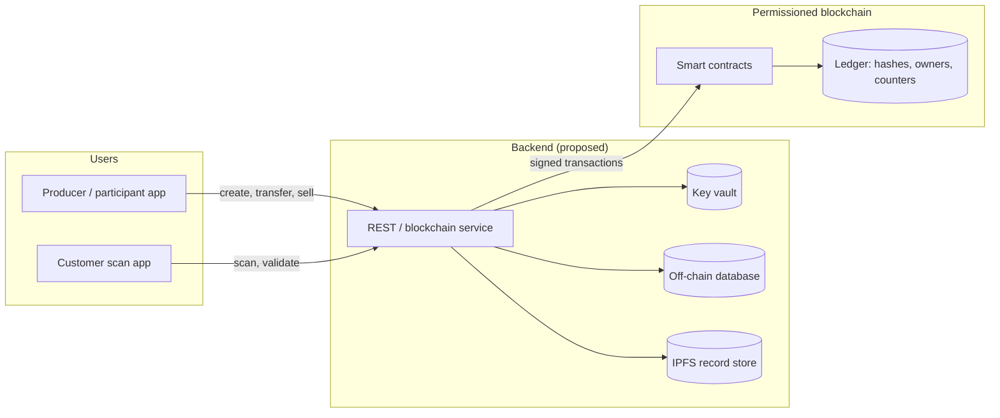
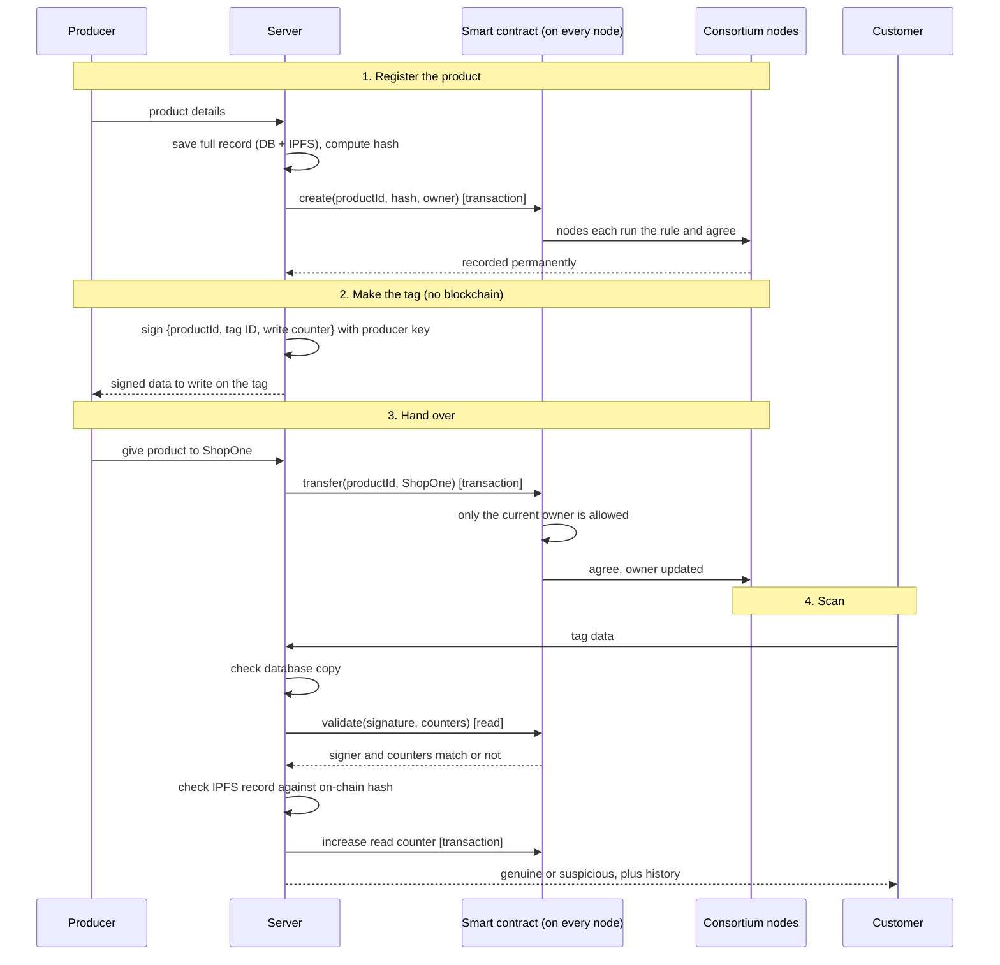
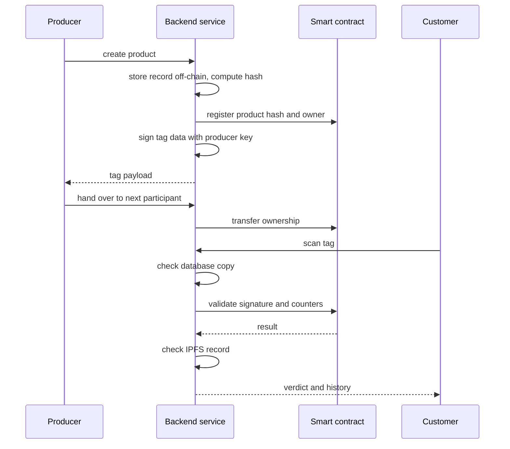
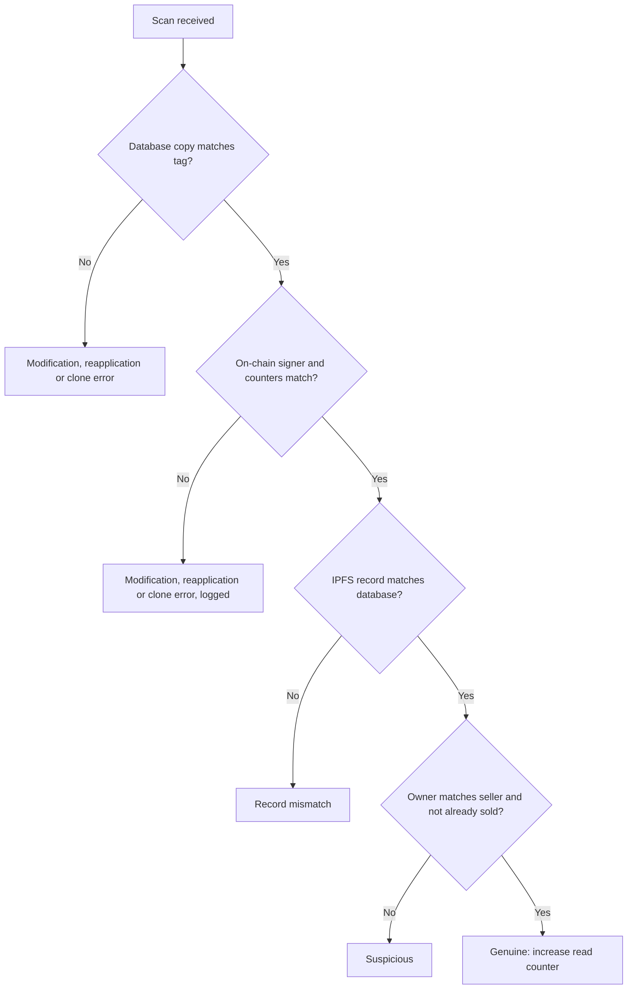
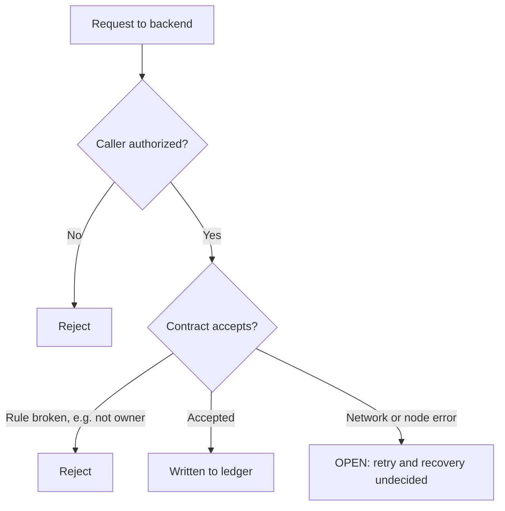
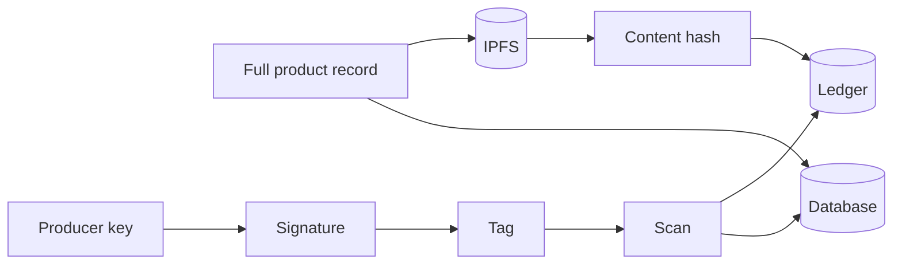

# Blockchain-Based Product Authenticity Checker: Design Explained

> **Read this first: what this document is based on**
>
> - The project folder contains no design files or code. The only sources are the chat between the student and Claude (an AI assistant) and four downloaded papers in `papers/`.
> - The student confirmed only a few things (Section 4). Almost every technical choice below is an **AI proposal**, not an agreed decision.
> - Nothing has been built or tested. Every flow describes a *proposed* system.
> - **How much of each paper was read:** R3 was read in full. Yiu's dNAS paper was read through its system model, architecture, implementation and validation sections (not the full paper). Musamih and Yiu's "Toward…" paper were skimmed (implementation, testing and cost sections for Musamih; threat analysis for "Toward…"). Statements about those are limited accordingly.
> - All numbers in the example in Section 11 are **illustrative**.
> - "Turn N" means the Nth student message in the chat that began with the research request.

---

## 1. Project Overview

**What we are thinking of building:** a system where a shopper checks whether a product is genuine by scanning a tag on it and comparing it with a tamper-resistant record kept on a blockchain.

**How it started:** the student is preparing a class presentation on "Blockchain-Based Product Authenticity Checker" (Turn 1). First came research only (papers, sources, no slides). Later turns shifted toward a design that could be built. It is **not yet decided** whether the final deliverable is a presentation, a working demo, or both (Section 16).

**In one paragraph:** A manufacturer registers each product on a shared ledger. The product carries a tag whose content is digitally signed. When someone scans it, a server checks the signature and a counter, then reads the ledger to answer: is this product registered, who holds it now, has it already been sold, and what is its history?

---

## 2. Problem Statement and Objectives

**Problem:** counterfeit goods look like real ones. Basic barcodes, QR codes and NFC/RFID tags can be copied, so a copied code on a fake product can pass a simple check. One of the chosen papers (Yiu, "Toward…") names three common attacks on centralized systems: changing the record stored in a tag, cloning a genuine tag's data onto a fake product, and removing a genuine tag and reapplying it to a fake.

**Why it matters:** an OECD and EUIPO press release (7 May 2025) estimates USD 467 billion of counterfeit trade in 2021, 2.3% of global imports. This came from a press-release summary only; the full report was not opened.

**Objectives (proposed, not formally agreed):**

1. Let a buyer check a product's origin, current owner and history.
2. Make the history hard to rewrite afterward.
3. Detect modified, copied or re-applied tags where possible.
4. Keep the design simple enough for a student to explain and, ideally, build.

---

## 3. Scope: What Is Included and Excluded


| Item                                 | Status                            | Notes                                          |
| ------------------------------------ | --------------------------------- | ---------------------------------------------- |
| Research papers and sources          | **Done** (Turns 1–3)              | Verified against publisher or database records |
| Slides, outline, speech              | **Excluded for now**              | Student said not yet (Turn 1)                  |
| Design for the authenticity system   | **Proposed**                      | Built across later turns                       |
| Working code or deployment           | **Not started**                   | No files exist                                 |
| Proving a physical object is genuine | **Not possible with this design** | See "oracle problem", Section 5                |


**The system would:** register products, record ownership changes, sign tags, validate scans, show history.

**It would not:** inspect the physical item, stop someone moving a real tag onto a fake item, or work without trusting the organizations that enter data.

---

## 4. Current Design Status

"User" means the student's own messages. "AI" means Claude's suggestions.

### Finalized (explicitly said or accepted by the user)


| Item                                                                                                  | Evidence                                                                                                                             |
| ----------------------------------------------------------------------------------------------------- | ------------------------------------------------------------------------------------------------------------------------------------ |
| Research first, no slides yet                                                                         | User, Turn 1                                                                                                                         |
| Papers R2 (SPOQchain) and R4 (luxury resale survey) are not needed                                    | User, Turn 6                                                                                                                         |
| The design rests on **four papers only**: R3 (Ho Dac et al.), Yiu dNAS, Musamih et al., Yiu "Toward…" | User asked for 3–4 papers max; the AI proposed these four; the user replied "sure" and had the other papers moved to `papers_other/` |
| Papers outside those four are kept for reference only                                                 | User                                                                                                                                 |


### Proposed (AI suggestion, not approved)


| Item                                                              | Source                                                           |
| ----------------------------------------------------------------- | ---------------------------------------------------------------- |
| Ethereum-compatible platform (Solidity contracts)                 | AI recommendation, last turn; **the user has not chosen**        |
| Product records, roles and lifecycle flow                         | R3                                                               |
| Signed tag content, checked on-chain                              | dNAS                                                             |
| Write counter and read counter to catch re-applied or cloned tags | dNAS                                                             |
| Content hash on-chain, full record off-chain (IPFS)               | dNAS, Musamih                                                    |
| Owner-only functions via authorization checks                     | Musamih                                                          |
| Threat list used as a test checklist                              | Yiu "Toward…"                                                    |
| A REST API server in front of the chain                           | AI (dNAS uses a similar "blockchain service" with API endpoints) |
| Starting with QR, adding NFC later                                | AI; **see the problem this causes in Section 5**                 |


### Open questions

See Section 16.

### Rejected / dropped


| Item                                         | By whom                                                                                                                       |
| -------------------------------------------- | ----------------------------------------------------------------------------------------------------------------------------- |
| R2, R4                                       | User                                                                                                                          |
| R1 ArtProtect, Toyoda 2017, Subramaniam 2025 | **Dropped from the plan because full text was not available**; this was a practical decision, not a judgment on their quality |
| Gupta 2023, Westerkamp 2018                  | Moved to reference folder by the user's request; not used by the plan                                                         |


### Unverified


| Item                                            | Why                                             |
| ----------------------------------------------- | ----------------------------------------------- |
| R3's GitHub code                                | The link is not in the paper text; never opened |
| Musamih's and Toward's finer details            | Skimmed only                                    |
| Whether any of the designs hold up when rebuilt | Nothing has been tested                         |


### How the plan evolved

1. R3 was first proposed as the base because it is the most buildable.
2. Reading R3 in full showed a weakness: it checks a barcode, which is easy to copy.
3. The AI first invented a "scan counter" fix, based on abstracts.
4. After reading dNAS in detail, the plan was changed: dNAS already contains a signature-and-counter validation. The plan now **cites dNAS instead of relying on the AI's own idea**.
5. R1/Toyoda/Subramaniam were removed because their full text could not be downloaded.

---

## 5. Important Technical Concepts Explained From Basics

**Blockchain.** A shared record book copied across many computers. Entries are grouped into blocks, and each block holds a fingerprint (hash) of the one before it, so editing old entries breaks the chain and is noticed.
*Without it:* one company's database could be edited by that company alone.
*Trade-off:* slower and more complex than a normal database.

**Permissioned vs. public.** In a public chain anyone can join. In a permissioned chain only approved organizations can. dNAS builds a permissioned network and names two options: Ethereum software with Proof-of-Authority (PoA), or Quorum with Istanbul Byzantine Fault Tolerant (IBFT) consensus; R3 uses Hyperledger Fabric. See "Appendix: Blockchain Basics", section 3A, for what each paper says about consensus.

**Smart contract.** A program stored on the blockchain that enforces rules, e.g. "only the current owner may transfer this product." Hyperledger Fabric calls these *chaincode*. Ethereum contracts are written in Solidity.

**Node, ledger and consensus.** A *node* is a computer running the blockchain software. Every full node keeps a copy of the ledger (all blocks) and of the current *state* (every account and every contract with its stored values). *Consensus* is the rule by which nodes agree on which transactions are accepted and in what order. In dNAS's Proof-of-Authority setup, a small set of approved organizations (the authorities) produce and sign blocks, and every other node checks them. Because every full node also **re-runs each contract call itself**, a result cannot be faked by one machine. *Trade-off:* the whole network repeats the work, which is why public chains charge a fee (gas) and why a permissioned chain is chosen here to avoid it.

**Transaction vs. read-only call.** A *transaction* changes the ledger (create a product, transfer, increase a counter). It is signed, sent to the network, ordered and agreed through consensus, and stored permanently. A *read-only call* only reads the current state. It is answered by **one node**, needs no consensus, and changes nothing. Section 8A uses this split to show where consensus matters in this design.

**Contract address and ABI.** The ledger holds many contracts, so each one has an **address** that identifies it; every transaction is sent *to* that address. The **ABI** is a JSON description of the contract's functions, which the server needs to build calls and read answers. The contract itself (code and stored values) lives **on the chain**, held by every full node. The server's configuration or database stores only the address, ABI and network (see Section 8A).

**Hash.** A fixed-length fingerprint of data. Changing one letter changes it completely. Used to prove data has not been altered, without storing the data.

**Digital signature.** Someone with a private key stamps data. Anyone with the matching public key can check who signed it and that it was not changed.

**IPFS / off-chain storage.** A place to keep the full product record or images. Only its hash goes on the blockchain, which keeps the chain small and cheap (dNAS, Musamih).

**API and REST.** An API is a defined way for one program to ask another to do something. REST is a common style using web addresses and actions such as GET (read) and POST (change).

**Authentication vs. authorization.** *Authentication:* who are you (login)? *Authorization:* are you allowed to do this (only a producer may create products)?

**Database, service, queue, event, webhook, worker, cache.** A database stores data on disk (dNAS uses one for off-chain records). A service is a program that runs continuously (the REST server). The others (queue, event, webhook, worker, cache) were **not part of any chosen paper's core flow** and are not in this design. (R3 mentions Kafka queuing, but it is not used in its main flow.)

**NFC and QR.** Two ways to carry data on a product. QR is a printed picture; NFC is a small chip a phone can read. NTAG 216, the NFC chip dNAS selects, supports password lock and a built-in scan counter, and can be rewritten.

**The tag counters (from dNAS).** Two counters are compared during a scan: a *write counter* (how many times the tag was written) and a *read counter* (how many times it was scanned). The tag, the off-chain database and the blockchain each hold a copy. If they disagree, something is wrong, e.g. a copied tag.

> > **Important consequence for the QR idea (AI analysis, not stated by the papers): a printed QR cannot be rewritten and cannot hold a counter that changes on each scan. So the counter-based protection above works with an NFC tag, not with plain QR. With QR you can still check the signature and the on-chain read count, but you cannot tell a copy from the original through counters. This is why QR vs. NFC is an open question in Section 16.**
>
> **Oracle problem. The blockchain can only guarantee a record was not changed *after* it was written. It cannot confirm the record matches the physical object (Caldarelli et al. 2020; Powell et al. 2021/2022, both from earlier research, not among the four chosen papers).
> *Example:* a genuine bottle's tag is peeled off and stuck on a fake bottle. The ledger still says "genuine."**

---

## 6. Proposed System Architecture


| Component                                       | Purpose                                                           | Source                                                             | Status                  |
| ----------------------------------------------- | ----------------------------------------------------------------- | ------------------------------------------------------------------ | ----------------------- |
| Blockchain network (permissioned)               | Stores product hashes, owners, history; runs rules                | R3, dNAS, Musamih                                                  | Proposed; platform open |
| Smart contracts                                 | Enforce who can create, transfer, sell; validate scans            | R3 (flows), dNAS (validation), Musamih (algorithms, authorization) | Proposed                |
| Consortium / identity management                | Only approved organizations can write; admin approves new members | R3 (admin and certifying agency), dNAS (administrator and voting)  | Proposed                |
| Blockchain interface (REST server)              | Receives app requests, signs and sends transactions               | dNAS (blockchain service), AI                                      | Proposed                |
| Key vault                                       | Safely stores each organization's signing keys                    | dNAS                                                               | Proposed                |
| Off-chain record store (database + IPFS)        | Holds full records; hash on-chain                                 | dNAS, Musamih                                                      | Proposed                |
| Tag (NFC preferred, QR possible)                | Carries signed product data                                       | dNAS (NTAG 216), Musamih (QR)                                      | Proposed; open          |
| Producer/organization app and customer scan app | User interfaces                                                   | dNAS (TagWINE and ScanWINE are its examples)                       | Proposed; none chosen   |


**Roles:**

- R3: admin, certifying agency, producer, supplier, retailer, customer.
- dNAS: manufacturer, supply chain participant, consumer, consortium administrator.
- This design (proposed): merge them into admin, producer, supply-chain participant, customer.

**Data (from R3, read in full):**

- `User {userName, hashPassword, fullName, address, phone, logo, type}`
- `Technology {key, name, register, registrationDate, certifyingAgency, status}`
- `Product {key, name, image, description, price, techKey, producer, owner, transfer, status}` plus a history field.

**Additions from dNAS:** the on-chain record holds a content hash, the tag signer's public address, tag identifier, write counter and read counter, and a log of unsuccessful validations. Exact field names for this project are not decided.

---

## 7. High-Level Architecture Diagram

> **Everything here is proposed. Nothing is built.**




**How to read it:**

1. Users never talk to the blockchain directly. They go through the server.
2. The server fetches signing keys from the vault, keeps full records off-chain, and sends signed transactions to the smart contracts.
3. The contracts check the rules and read or write the ledger.
4. The platform (Ethereum-style or Fabric) and the tag type are still open.

---

## 8. Complete End-to-End Flow

Source tags: **[R3]**, **[dNAS]**, **[Musamih]**, **[Toward]** for the papers; **[AI]** for my own design. Status for every row is **Proposed** unless stated.

### Phase A: Setup


| #   | Trigger                              | Component                   | Input → Action → Output                                                                          | Why                                 | Source                                                                |
| --- | ------------------------------------ | --------------------------- | ------------------------------------------------------------------------------------------------ | ----------------------------------- | --------------------------------------------------------------------- |
| 1   | An organization wants to join        | Admin + identity management | Credentials → admin verifies, issues an account and key (keys held in a vault) → member can sign | Only known parties may write        | R3, dNAS                                                              |
| 2   | New member needs consortium approval | Existing members (voting)   | Join request → members vote → member added                                                       | No single party controls membership | dNAS (voting among members); R3 uses an admin instead; **choose one** |
| 3   | Producer wants to make a product     | Technology licence          | Technology details → certifying agency signs → licence recorded                                  | Only authorized producers           | R3                                                                    |


### Phase B: Product creation and tagging


| #   | Trigger                    | Component                  | Input → Action → Output                                                                                                                            | Why                                    | Source            |
| --- | -------------------------- | -------------------------- | -------------------------------------------------------------------------------------------------------------------------------------------------- | -------------------------------------- | ----------------- |
| 4   | Producer creates a product | Contract + off-chain store | Product details → full record stored off-chain (IPFS and database); its **hash** and owner written on-chain; only an authorized caller may do this | Small ledger, tamper-evident           | R3, dNAS, Musamih |
| 5   | Producer prepares the tag  | Server + key vault         | Product ID, counters (start at 0) → data signed with the producer's key → written to the tag                                                       | A forged tag fails the signature check | dNAS              |


### Phase C: Distribution


| #   | Trigger                                | Component           | Input → Action → Output                                                                                                                                                              | Why                                | Source                       |
| --- | -------------------------------------- | ------------------- | ------------------------------------------------------------------------------------------------------------------------------------------------------------------------------------ | ---------------------------------- | ---------------------------- |
| 6   | Product handed to the next participant | Contract (transfer) | Product, new owner → only the current owner may call → owner and history updated                                                                                                     | Keeps custody trail                | R3, Musamih                  |
| 7   | Participant accepts the physical item  | Scan app            | Scan tag → validation (Phase E) → if valid, participant accepts, then rewrites the tag with their own signature and increments the write counter, and the on-chain record is updated | Detects tampering on each handover | dNAS (NFC tag is rewritable) |


### Phase D: Sale


| #   | Trigger       | Component       | Input → Action → Output                                                     | Why                            | Source                                                                      |
| --- | ------------- | --------------- | --------------------------------------------------------------------------- | ------------------------------ | --------------------------------------------------------------------------- |
| 8   | Customer buys | Contract (sale) | Product → validation first → owner changes to buyer and status becomes sold | Sold items can't be sold again | R3, dNAS (consumer purchase updates records), Musamih (grant sale then buy) |


### Phase E: Validation (the core)

dNAS describes a **three-layer** validation:


| #   | Layer              | What is checked                                                                                                                                                  | Result if wrong                              |
| --- | ------------------ | ---------------------------------------------------------------------------------------------------------------------------------------------------------------- | -------------------------------------------- |
| 9   | Off-chain database | Tag identifier and signature match the stored record; write and read counters match                                                                              | Modification, reapplication or cloning error |
| 10  | On-chain           | The signer's address recovered from the tag data matches the address registered on-chain for this product; counters and tag identifier match the on-chain values | Same three error types                       |
| 11  | IPFS               | The latest record version fetched via the on-chain hash matches the database copy                                                                                | Record mismatch                              |


After success, the read counter is increased in all three places, and the product history is shown. A failed validation is logged on the record as unsuccessful validation data, and the related participants are notified. **[dNAS]**

R3's extra rule, kept as an additional check: flag the product if the owner does not match the seller, or if it is already sold. **[R3]**

**Synchronous vs. asynchronous:** every step is request and wait. There are no queues or background workers in the design. Human steps: admin approval, certifier signing, member voting.

---

## 8A. How the Blockchain Works in This System

*This is the proposed design explained as one story. No contract has been written yet; the mechanisms come from dNAS, R3 and Musamih (Section 8).*

### The idea in one minute

Think of the blockchain as a **shared notebook**. Several organizations (the producer, the shops, the certifying agency) each hold an identical copy. Anyone can add a new line, but only if it follows the rules written in the notebook's **smart contract**, and once a line is in, it cannot be quietly erased, because every other copy would disagree.

The notebook is slow and public-ish, so we only put the facts in it that must never be changed secretly: *which product exists, a fingerprint of its record, who owns it now, and how many times its tag has been written and scanned.* Everything bulky or private (photos, descriptions, keys) stays with the server.

### Who is involved

- **Producer / shop:** uses an app to create products and hand them over.
- **Server:** the only thing that talks to the blockchain. It holds the signing keys, the database and the IPFS copy.
- **Smart contract:** the rulebook stored on the blockchain. It decides what is allowed.
- **Nodes:** the computers (run by the consortium members) that each keep a copy of the notebook and check every new line.
- **Customer:** scans the tag and wants a straight answer.

### The whole flow at a glance




Two kinds of requests appear in this diagram, and the difference is the key to the whole design:

- A **transaction** changes the notebook. It must be agreed by the network (consensus), so it is slower, but the result is permanent and every copy matches.
- A **read** only looks at the notebook. One node answers it immediately, and nothing changes.

### Step 1: Registering a product

The producer enters the product's details. The server keeps the **full record** in its database and in IPFS, then computes the record's **hash**, a short fingerprint that changes completely if even one letter of the record changes.

The server then sends a **transaction** to the smart contract: *"create product W-1001, with this hash, owned by AcmeWatches."* Every consortium node runs the contract's rule independently (is the caller an approved producer? is this ID unused?), and if the network agrees, the entry is written into every copy of the notebook.

**Why this matters:** later, anyone can fetch the record, hash it again and compare it with the hash in the notebook. If someone edited the record in the server's database, the hashes differ and the edit is exposed. The server can no longer rewrite history without being caught.

### Step 2: Making the tag (the blockchain is not involved)

The server builds the tag data, for example *"product W-1001, tag ID 04:A2, write counter 0"*, and **signs** it with the producer's private key. The signed data is written to the NFC tag.

The **read counter is not part of what is signed.** It changes on every scan, and any change to signed data would break the signature. Instead the NFC chip raises its own read counter each time it is read, and the system compares that number with the server's and the blockchain's copies (see "Appendix: Blockchain Basics", section 9).

No blockchain call happens here. A signature is just maths: it proves *this exact data came from the holder of this key and has not been altered*. The blockchain comes in later, because the contract stores which public address is the legitimate signer for W-1001, so it can check the tag against it.

### Step 3: Handing the product over

> ```
> When AcmeWatches ships the watch to ShopOne, the server sends another transaction: "transfer W-1001 to ShopOne."
> ```
>
> ```
> The contract first asks: is the caller the current owner? If not, the transaction is rejected, and every node enforces this identically, so no one can hand over a product they do not hold. If it passes, the owner is updated and the change is recorded with the previous owner, which builds a permanent chain of custody: Acme → ShopOne → buyer.
> ```
>
> ```
> ShopOne then scans the tag (the validation in Step 4 runs), and if it passes, the tag is rewritten with ShopOne's signature and the write counter goes up by one. The same update is made on-chain so tag and ledger stay in step.
> ```

### Step 4: A customer scans the tag

This is where the blockchain does its most visible work. The server answers in three layers, cheapest first:

1. **Database check (server only).** Does the tag's identifier and signature match the stored record, and do the counters agree? A mismatch means the tag was modified, copied or moved.
2. **Blockchain check (the contract).** The server sends the tag data to the contract, which does the following in order:
  1. *Does this product exist?* If the ID was never registered, stop.
  2. *Rebuild the signed message* from the tag data, exactly as the signer did.
  3. *Recover the signer's address* from the signature and compare it with the address registered on-chain for W-1001. If anyone altered the tag data, the recovered address would be different, so this catches **modified** tags.
  4. *Compare the counters and tag identifier* with the on-chain values. If someone copied the tag onto a blank one, or moved it to another product, the counters or identifier will no longer line up with the original, so this catches **cloned** and **re-applied** tags.
3. **IPFS check.** The server uses the on-chain hash to fetch the latest record from IPFS and compares it with its database copy. Different? The record was tampered with.

If everything passes, the read counter is increased in all three places (tag, database, blockchain) and the server returns *genuine*, together with the product's history. If anything fails, the failure is logged on the product and the related participants are notified.

```solidity
// Illustration of what the contract does (not from a paper or this project)
function validate(bytes32 id, bytes32 tagId, uint256 wc, uint256 rc, bytes calldata sig) external {
    Product storage p = products[id];
    require(p.owner != address(0), "unknown product");                          // 1. exists?
    bytes32 msgHash = keccak256(abi.encodePacked(id, tagId, wc, address(this)));     // 2. rebuild signed message (read counter not signed)
    require(recover(msgHash, sig) == p.signer, "bad signature");                // 3. right signer?
    require(tagId == p.tagId && wc == p.writeCounter && rc == p.readCounter,
            "counter mismatch");                                                // 4. clone / re-apply?
    p.readCounter += 1;                                                         // record this scan
}
```

**Why the last line forces a transaction.** The checks alone could be a free read. But the counter increase *changes* the notebook, so that scan must be a transaction agreed by the network. That is what makes the counter trustworthy: if two scans arrive at the same moment, the network puts them in a single order, and only the first can match the counter. A copied tag replaying an old counter is then rejected.

### Step 5: Selling to the customer

At sale, validation runs first. Then a **transaction** moves ownership to the buyer and marks the product *sold*. A sold product cannot be sold again, and if a "sold" product shows up for sale in a shop, the rule flags it as suspicious.

### Where does the contract actually live?

On the blockchain itself, not in the server's database. Every full node keeps a copy of the **contract code and its stored values** (products, owners, counters). When a transaction arrives, every node runs the code separately and they compare results. That is how the network agrees without trusting any one machine.

The network holds many contracts, so each one has an **address**, like a house number. The server sends every request *to* our contract's address, so the nodes know which code to run.

The server's database or config therefore stores only what it needs to reach the contract:

- the **contract address** (which contract to call),
- the **ABI** (the contract's list of functions, so the server can build calls and read answers),
- the **network** it is deployed on.

If someone could change that stored address, they could point the server at a fake contract, and every check would pass against fake data. So this setting must be protected like a key.

### What the blockchain guarantees, and what it does not

**It guarantees** that once a product, owner or counter is written, it cannot be quietly changed; that only the current owner can transfer a product; that the tag's signer and counters can be checked against a record every organization agrees on; and that the record's hash exposes any later edit.

**It does not guarantee** that the data was true when entered (a hash only proves it is unchanged), that the tag is on the right physical item (the oracle problem in Section 5), or that the server is honest in the steps it handles itself, such as the database check. If a producer's signing key leaks, valid-looking tags can be made until the key is revoked, and revocation is not yet designed (Section 12).

Two practical points follow. A read answers from **one node**, so which node the server asks matters. And on a demo with a single local node there is effectively no consensus, because one machine could rewrite everything. The guarantees above need several independent organizations running nodes.

So the design is a **hybrid**: the blockchain is the tamper-evident ledger for ownership, hashes and counters, and the server does the private, fast work around it.

---

## 9. Detailed Flow Diagrams

### 9.1 Main sequence (proposed)




**Step by step:**

1. The producer creates a product. The server keeps the full record off-chain and writes its hash and owner to the contract.
2. The server signs the tag data and returns it for writing onto the tag.
3. Each handover is an owner-only contract call.
4. At scan time the server checks its database, then asks the contract to validate the signature and counters, then checks the IPFS copy, and then answers.

### 9.2 Validation decisions (proposed)




**Explanation:** Checks run from cheapest to most thorough. The first three come from dNAS. The last is R3's rule.

### 9.3 Failure handling

> **Retries, recovery and key revocation were not covered by any chosen paper.** The diagram shows only failures the papers or chat identified.




### 9.4 Data flow




---

## 10. Important Technical Decisions and Their Rationale


| Decision                                   | Why considered                                                            | Alternatives discussed        | Rationale (from chat/papers)                                                        | Risks                                                                      | Status   |
| ------------------------------------------ | ------------------------------------------------------------------------- | ----------------------------- | ----------------------------------------------------------------------------------- | -------------------------------------------------------------------------- | -------- |
| Use R3's data model and lifecycle          | Only chosen paper with a full register-to-sold flow and published latency | R1, R2, R4 (dropped)          | Clear roles and steps                                                               | Uses a copyable barcode; 20 nodes tested on a single PC; no attack testing | Proposed |
| Signature and counter validation from dNAS | Fixes R3's copyable-barcode weakness                                      | AI's earlier invented counter | Published design with named attack classes                                          | Needs rewritable NFC; wine-specific prototype                              | Proposed |
| Hash on-chain, record off-chain            | Cheaper, smaller ledger                                                   | Store everything on-chain     | Both dNAS and Musamih do this                                                       | Off-chain storage needs its own security                                   | Proposed |
| Owner-only functions                       | Prevent misuse                                                            | None                          | Musamih's authorization modifiers; R3's owner checks                                | Depends on correct key handling                                            | Proposed |
| Ethereum-compatible platform               | Two of four papers (dNAS, Musamih) use Solidity                           | Hyperledger Fabric (R3)       | Easier to set up; more reusable contract designs                                    | Public-chain costs unless run as a private network                         | **Open** |
| REST server                                | Hide keys and chain details from apps                                     | Apps call chain directly      | dNAS has a comparable blockchain service with API endpoints                         | Adds one more component to secure                                          | Proposed |
| Threat checklist from "Toward…"            | Gives test cases                                                          | None                          | Names T01 tag cloning, T08 relay attack, T11 denial of service, T14 record spoofing | Not all threats are addressed by the design                                | Proposed |


---

## 11. Realistic Example Walkthrough

**All names and values are illustrative.**

**Scenario:** "AcmeWatches" makes a watch with an NFC tag. "ShopOne" sells it. A buyer checks it.

1. **Setup.** The admin approves AcmeWatches and ShopOne. *State:* both can sign.
2. **Create.** AcmeWatches registers watch `W-1001`. The full record goes to IPFS, and its hash plus owner = AcmeWatches go on-chain. *State:* write counter 0, read counter 0.
3. **Tag.** The server signs `{W-1001, write 0}` with AcmeWatches' key and writes it to the NFC tag.
4. **Hand over to ShopOne.** ShopOne scans the tag, validation passes (read counter becomes 1). AcmeWatches transfers ownership, and ShopOne rewrites the tag with its own signature (write counter 1). *State:* owner = ShopOne.
5. **Customer checks in store.** The signature maps to ShopOne's registered address, counters match, the IPFS record matches, and the owner/unsold rule passes. *Result:* genuine.
6. **Sale.** The buyer's purchase moves ownership and marks it sold.

**Failures on the same watch:**

- **Altered tag data:** the signature or identifier no longer matches. *Result:* modification error, logged.
- **Cloned tag (data copied to a blank NFC tag):** the clone's counters or tag identifier diverge from the on-chain values after the original is used. *Result:* reapplication or cloning error. *(This is the design intent from dNAS; effectiveness here is untested.)*
- **Real tag moved to a fake watch:** all digital checks pass. *Result:* wrongly "genuine." The design cannot catch this.
- **Sold watch scanned in a shop:** R3's rule flags it as suspicious.

---

## 12. Failure Scenarios, Edge Cases, and Recovery


| What could go wrong                    | Why                                              | System should                   | Solution proposed?                   | Final?   | Still to decide                                        |
| -------------------------------------- | ------------------------------------------------ | ------------------------------- | ------------------------------------ | -------- | ------------------------------------------------------ |
| Modified tag data                      | Attacker edits the tag                           | Reject, log                     | Yes (dNAS validation)                | No       | Notification rules                                     |
| Re-applied tag                         | Tag moved between products                       | Counter mismatch error          | Partly (dNAS counters)               | No       | Whether it works on every tag type                     |
| Cloned tag                             | Data copied                                      | Counter and identifier mismatch | Yes (dNAS)                           | No       | Needs NFC; QR can't do this                            |
| Real tag on a fake item                | Blockchain can't see the object (oracle problem) | Can't be solved by the chain    | Not solved; Toward lists tag threats | No       | State it as a limitation; consider tamper-evident tags |
| Relay / man-in-the-middle attack (T08) | Scan relayed through an attacker                 | Not covered                     | Listed in Toward; no fix chosen      | No       | Decide whether to mention only or mitigate             |
| Denial of service (T11)                | Flooding the service                             | Not covered                     | Listed in Toward                     | No       | Same                                                   |
| Spoofing record data (T14)             | Fake login or data entry                         | Authentication                  | Partly (signed identities)           | No       | Details                                                |
| Non-owner tries to transfer            | Misuse                                           | Reject                          | Yes (owner-only checks)              | Proposed | N/A                                                    |
| Network or node failure                | Infrastructure                                   | Retry or report error           | **Not discussed**                    | No       | Recovery plan                                          |
| Private key stolen                     | Compromise                                       | Revoke and re-issue             | **Not discussed**                    | No       | Key management                                         |
| Off-chain database or IPFS data lost   | Off-chain parts are outside the chain            | Restore                         | **Not discussed**                    | No       | Backup plan                                            |
| Wrong data entered by producers        | Garbage in, garbage out                          | Unsolved by blockchain          | Acknowledged as a limitation         | No       | Governance                                             |
| Scale                                  | R3 measured 63–88 blocks/minute on one PC        | Handle load                     | Future work in R3                    | No       | Realistic volume                                       |


---

## 13. Dependencies, Limitations, and Risks

**Dependencies:** a blockchain network and contracts, key vault, backend service, off-chain database and IPFS, tag hardware (NFC reader/writer and rewritable tags if using NFC), and organizations entering correct data.

**Limitations:**

- No proof the object matches the record.
- R3 evaluated latency only, not attacks, and ran 20 nodes on one machine.
- dNAS is a research prototype for wine and its evaluation was not reviewed here beyond its design.
- QR cannot support the counter checks (Section 5).
- Most cited papers are prototypes with self-reported results.
- A permissioned chain makes sense for several organizations that don't fully trust each other. If one company runs everything, a normal database may be simpler.

**Risks:** untested design, only partial reading of two papers, unresolved platform choice, no recovery plan, and uncertainty about the final deliverable.

---

## 14. Finalized Decisions vs Open Questions


| Finalized                                             | Open                                                       |
| ----------------------------------------------------- | ---------------------------------------------------------- |
| Research before slides                                | Presentation, demo, or both?                               |
| R2 and R4 not needed                                  | Ethereum-compatible or Hyperledger Fabric?                 |
| Four papers form the basis: R3, dNAS, Musamih, Toward | NFC or QR?                                                 |
| Other papers kept for reference only                  | Admin-approved membership (R3) or member voting (dNAS)?    |
|                                                       | Recovery, key management and retry rules                   |
|                                                       | Which threats beyond cloning and re-application to address |


---

## 15. Ideas Considered and Rejected


| Idea                                      | Rejected by              | Reason                                  |
| ----------------------------------------- | ------------------------ | --------------------------------------- |
| R2 SPOQchain                              | **User**                 | "Not needed"                            |
| R4 luxury resale survey                   | **User**                 | "Not needed"                            |
| R1 ArtProtect, Toyoda, Subramaniam        | Practical drop (AI plan) | Full text not available                 |
| Gupta 2023, Westerkamp 2018               | User moved them aside    | Not part of the four-paper plan         |
| The AI's original invented "scan counter" | Replaced                 | Superseded by dNAS's published counters |


---

## 16. What Still Needs to Be Decided Before Implementation

1. Final deliverable: presentation, demo, or both.
2. Platform: Ethereum-compatible (recommended by the AI) or Hyperledger Fabric.
3. Tag type: NFC (needed for counter checks and available hardware?) or QR with weaker protection.
4. Membership approach: admin or voting.
5. How to handle failures, retries and key loss.
6. Whether to read dNAS, Musamih and Toward fully before building from them.
7. Whether R3's code exists, runs and may be reused.
8. Read-counter tolerance: must the tag's counter be exactly the stored value + 1, or is a small gap allowed for scans that never reached the server? (Appendix: Blockchain Basics, section 9)
9. Who holds the signing key: the server's key vault (as proposed), the producer's own device, or a hardware security module? (Appendix, section 10)

---

## 17. Questions I Should Be Able to Answer

1. What problem does the system solve, and what can it not solve?
2. When is a blockchain better than a normal database here?
3. What does the smart contract enforce?
4. What are the three tag attacks, and how does the design detect each?
5. What do the write counter and read counter do?
6. Why does QR weaken the counter protection?
7. Why is the full record kept off-chain?
8. What is the oracle problem?
9. Which parts come from which paper, and which are the AI's own?
10. What is still undecided?
11. Which steps are blockchain transactions (with consensus) and which are read-only calls or plain server work? (Section 8A)
12. Is every contract stored on every node? What does the contract address do? (Section 5, 8A)
13. How does the contract detect a modified, cloned or re-applied tag? (Section 8A)
14. Why must the read-counter update be a transaction, and what breaks if it is only a read-only call? (Section 8A)
15. What does the server keep in its database about the contract, and why does that need protecting? (Section 8A)
16. What is the difference between a hash, a signature and encryption, and which does this design use? (Appendix: Blockchain Basics)
17. How does the contract find the signer's address, and why is the registered address needed? (Appendix, section 8)
18. What happens when the tag's read counter is lower or higher than the stored one? (Appendix, section 9)
19. Does every node verify a scan? (Appendix, section 6)
20. How does the network decide that a majority has agreed, and what happens to nodes that disagree? (Appendix, section 3A)
21. Which consensus mechanism does each of the papers use? (Appendix, section 3A)

---

## 18. Quick Revision: The Entire System in Five Minutes

- **Goal:** let a buyer check a product's authenticity using a signed tag and a shared tamper-resistant record.
- **Papers:** R3 (lifecycle and data), dNAS (signed tag, counters, three-layer validation), Musamih (contract algorithms and authorization), Toward (threat checklist).
- **Flow:** onboard organizations → create product (hash on-chain, record off-chain) → sign tag → hand over (owner-only) → validate every handover → sale → customer validation.
- **Validation:** database check, then on-chain signer and counters, then IPFS record, then R3's owner/sold rule.
- **Attacks detected (design intent):** modification, re-application, cloning.
- **Biggest limit:** the chain can't tell if a real tag was moved to a fake product.
- **QR caveat:** counters need rewritable NFC tags.
- **Confirmed so far:** research before slides, R2 and R4 out, four papers as the basis.
- **Open:** platform, tag type, deliverable. Nothing is built or tested.

---

## Appendix: Source Papers


| Paper                        | Citation                                                                                                                                                                                  | Type                  | How read                          |
| ---------------------------- | ----------------------------------------------------------------------------------------------------------------------------------------------------------------------------------------- | --------------------- | --------------------------------- |
| R3                           | Ho Dac et al., "A practical blockchain-based framework for anti-counterfeiting and traceability," CTU J. Innovation and Sustainable Development 15 (2023), DOI 10.22144/ctujoisd.2023.043 | Peer-reviewed journal | Full text                         |
| dNAS                         | Yiu, "Decentralizing Supply Chain Anti-Counterfeiting Systems Using Blockchain Technology," arXiv:2102.01456 (2021)                                                                       | Preprint              | Sections 1–6 including validation |
| Musamih                      | Musamih et al., "A Blockchain-Based Approach for Drug Traceability in Healthcare Supply Chain," IEEE Access 9 (2021), DOI 10.1109/ACCESS.2021.3049920                                     | Peer-reviewed journal | Skimmed                           |
| Toward                       | Yiu, "Toward Blockchain-Enabled Supply Chain Anti-Counterfeiting and Traceability," arXiv:2102.00459 (2021)                                                                               | Preprint              | Skimmed threat analysis           |
| Reference only (not in plan) | Caldarelli et al. 2020; Powell et al.; Zakari et al. 2022 (limitations and background); Gupta 2023; Westerkamp 2018                                                                       | Mixed                 | Abstract-level                    |
| Official docs                | ethereum.org smart-contracts page; Hyperledger Fabric "Introduction"                                                                                                                      | Documentation         | Pages opened                      |


---

## Appendix: Blockchain Basics

*A from-scratch explanation of the ideas used in Section 8A. Where a statement describes this project, it describes the proposed design, not a built system.*

### 1. What a blockchain is

A **shared notebook** that many computers each keep an identical copy of.

- Entries are written in **blocks** (pages).
- Each block carries the **hash** (fingerprint) of the previous block, which is what makes it a chain.
- If someone edits an old block, its hash changes, the next block no longer matches it, and that copy stops fitting the others.

```
Block 1            Block 2             Block 3
[entries ...]      [entries ...]       [entries ...]
hash: 0x11   <---  prev: 0x11          prev: 0x42
                   hash: 0x42   <----  hash: 0x9a
```

### 2. Nodes: who keeps the copies

A **node** is a computer running the blockchain software. A **full node** keeps the whole ledger and the current data (the *state*). In this design the nodes belong to the consortium members (producer, shops, certifier). Every full node holds the same data, and nobody owns a master copy.

### 3. How a new entry gets in

An entry is a **transaction**: a signed request such as "create product W-1001".

1. The server signs the transaction with its account key.
2. It sends it to a node, which passes it to the other nodes.
3. Each node checks it (valid signature? rules satisfied?).
4. An approved node bundles it into a new block.
5. The other nodes check that block and add it to their copy.
6. Everyone now holds the same entry, permanently.

The agreement in steps 3 to 5 is **consensus**. In dNAS's Proof-of-Authority setup, a small set of approved organizations take turns producing blocks, and everyone else verifies. Nodes agree not because they trust one another, but because each re-checks everything itself.

### 3A. Consensus in more detail

**How the network decides the majority has won.** No node counts the votes for everyone. Every node applies the **same fixed rule**, written into the blockchain software, to the messages it receives. Because the rule and the evidence are identical, each node reaches the same conclusion on its own. The common ways:

| Way | How it works | "Majority won" means |
| --- | --- | --- |
| **Explicit voting** (e.g. IBFT) | Each validator checks a proposed block and broadcasts a **signed vote**. Every node counts the valid signatures it holds. | A block is final once votes from more than about two-thirds of the validators exist. Signed votes cannot be forged or counted twice. |
| **Heaviest chain** (e.g. Clique-style PoA) | Approved signers take turns producing blocks. A new block builds on an earlier one, which counts as endorsing that history. Nodes follow a built-in rule: keep the branch with the most accumulated signer weight. | Most signers built on this branch, so every node picks it. The other branch is dropped and its transactions are included in a later block. |
| **Ordering service** (Hyperledger Fabric) | A small group of ordering nodes agrees the order of transactions, typically with a leader-based protocol such as Raft. | A batch is accepted once a majority of the ordering nodes has stored it. This handles crashed nodes better than nodes that actively lie. |

**What happens when some nodes agree and others do not.** The group that meets the threshold decides, and the record follows it. The nodes that disagree end up out of step and either catch up by downloading the majority chain, or stay on a version nobody uses. Their rejection does not change the agreed record.

| Reason nodes disagree | Result |
| --- | --- |
| Honest timing (a block has not reached a node yet) | The node catches up on its own |
| Old software or a bug | It rejects valid blocks until updated |
| An invalid block (breaks the contract rules) | The honest majority rejects it; it never joins the chain |
| An attack | Others reject it unless the attacker controls enough nodes |

Two valid blocks can sometimes appear at nearly the same moment. This is a **fork**; the network picks one branch by the rule above and drops the other, so a transaction is not treated as final the instant it appears.

**Why nobody can fake the result:** a node that claims the majority voted for its block is checked by the others, who count the signatures themselves; a node cannot vote twice because each validator has one key; and it cannot invent other validators' votes without their private keys.

**The limit.** The guarantee holds only while dishonest nodes stay **below the threshold** (in a typical voting protocol, fewer than one-third of validators). If one party controls most of the consortium, it can decide the result alone. This is why the members should be independent organizations. On a single-node demo, no disagreement can occur, so this protection does not exist.

**What each paper says about consensus** *(found by searching the papers' text for consensus terms and reading the passages found, not by reading each paper in full)*:

| Paper | Consensus named | What it says |
| --- | --- | --- |
| dNAS (Yiu) | **Proof-of-Authority** on Ethereum, or **IBFT** on Quorum | Two options, both in a permissioned consortium. *Validator nodes* validate transactions and sign blocks; *listener nodes* only read the chain's state. Clique and Aura are named as PoA implementations. |
| R3 (Ho Dac) | **Hyperledger Fabric**; no protocol named | Says the node spread and consensus mechanism between nodes are key to privacy, security and transparency. No ordering protocol (such as Raft) was found in the text. |
| Musamih | Ethereum's own consensus | Calls Ethereum a permissionless public platform and tests contracts in Remix IDE. It does not choose or configure a consensus method. |
| Toward (Yiu) | None chosen | Explains Proof-of-Work and consensus as background and does not pick one for a system. |

**A second, separate "consensus" in dNAS.** dNAS also defines a *consensus level*: the number of consortium members' votes needed to **add or remove a node**, which the administrator can change. This is a governance vote about membership, not the mechanism that agrees on blocks.

The exact threshold and fork rule can only be stated once the platform is chosen (Section 16, item 2).

### 4. Accounts, keys and addresses

Everyone who writes has a **key pair**.

| Part | Role | Secret? |
| --- | --- | --- |
| Private key | Signs things | Yes |
| Public key | Checks signatures | No |
| Address | Short ID derived from the public key, e.g. `0xA1b2...` | No |

The address works like a username that only the private-key holder can act as. Going from the private key to the address is easy; going back is practically impossible.

### 5. Smart contract: code plus saved data

A contract lives **on the blockchain** and has two parts:

| Part | What it is |
| --- | --- |
| Code | The rules (`create`, `transfer`, `validate`) |
| Storage | The saved table of data, e.g. one row per product |

```
products[W-1001] = { signer: 0xA1b2..., tagId: 04:A2, writeCounter: 1,
                     readCounter: 3, dataHash: 0x55e0..., owner: ShopOne }
```

**Every full node holds the contract's code and this storage.** The chain holds many contracts, so each has an **address** (like a house number) that requests are sent to. The address is the contract's name, not a machine's location.

The server stores only how to reach the contract: the contract **address**, the **ABI** (the list of its functions) and the **network**. The contract itself is not in the server's database.

### 6. Two ways to use a contract

| | Read-only call | Transaction |
| --- | --- | --- |
| Changes data? | No | Yes |
| Runs on | **One node** | **Every node** |
| Agreed by the network? | No | Yes (consensus) |
| Speed / cost | Fast, free | Slower, costs gas on public chains |
| Trust | You trust the one node asked | Many nodes verify |

So "does every node verify a scan?" has two answers. The quick check (signature and counters) is usually a read answered by one node. The counter update is a transaction that every node runs and agrees on. Nodes do not compare results with each other during execution; each runs the same code on the same data, and agreement follows because the results are identical.

### 7. Hash, signature and encryption

| Tool | What it does | Key needed? | Hides data? |
| --- | --- | --- | --- |
| Hash | A fingerprint of data; any change gives a completely different one | No | No |
| Signature | Proves who made the data and that it is unchanged | Private key to make, public key to check | **No** |
| Encryption | Hides data so only the key holder can read it | Yes | **Yes** |

- The tag is **signed, not encrypted**. Its contents stay readable by any phone; the signature is an extra value attached to them.
- A **signed message** means the message plus its signature. The hash is only a middle step: `signature = sign(hash(message), private key)`, and the message and signature are what get stored or sent.
- A hash alone is not enough, because anyone can compute one, including a forger. The signature adds the "who".
- If someone changes a detail, the receiver recomputes a different hash, and the old signature no longer fits it.
- Encryption is not used in the current design. If the off-chain record is sensitive, it could be encrypted before it goes to IPFS; that is an open choice.

### 8. How the signer is found

The signature is built from the hash and the private key so that only the matching public key fits as the answer to a puzzle. At a scan, the contract:

1. Rebuilds the hash from the tag fields.
2. Feeds the hash and the signature to a built-in function (`ecrecover` in Ethereum).
3. Gets back the address of the key that signed.
4. Compares it with the address saved for W-1001 in its storage.

| Address | Where from | Meaning |
| --- | --- | --- |
| Recovered | Calculated from this scan | The actual signer |
| Registered | Looked up in contract storage | The expected signer |

- The customer **does not send** the address; the contract calculates it. If the scan carried the address, a forger could simply write the correct public address on a fake tag.
- The **registered address is needed** because anyone can make a valid signature with their own key. Without a known expected signer, the contract could not tell a forger from the producer.
- The registered address comes from onboarding (the admin issues the producer a key and records its address as approved) and from registration (the signed create-transaction reveals the sender's address, which the contract saves as the signer for that product).
- A changed field gives a different hash, so the same signature recovers a different, unrelated address, and the tag is rejected. A forger who signs with their own key recovers to their own address, which does not match.

### 9. The tag and its counters

| Field | Signed? | Why |
| --- | --- | --- |
| Product ID, tag ID (the chip's serial), write counter | Yes | They change only when the tag is rewritten, and then it is re-signed |
| Read counter | **No** | It changes on every scan, so the chip raises it itself |

At a scan, compare the tag's read counter with the stored one:

| Tag counter | Meaning |
| --- | --- |
| Stored + 1 | Normal |
| Lower than stored | Stale: a copy, a replay or a reset chip, so flag it |
| Higher than expected | Probably scans that never reached the server; how large a gap to accept is **open** (Section 16) |

### 10. The signing key

In the proposed design the server signs tags using the producer's key from its **key vault**, so the server can create valid signatures. The contract can prove "this was signed by that key"; it cannot prove the producer approved it. A stolen vault or a dishonest operator can therefore make valid-looking tags. Options to reduce this, none chosen yet: signing on the producer's own device, a hardware security module, per-producer keys, key rotation and revocation, or multi-signature approval.

### 11. Where each fact lives

| Place | Holds | Why |
| --- | --- | --- |
| Tag | Readable fields, signature, chip read counter | Small and readable by anyone |
| Server (database, IPFS, key vault) | Full record, tag details for comparison, signing keys, contract address and ABI | Big and private |
| Blockchain contract | Record hash, signer address, owner, counters, history | Facts nobody should change quietly |

Two different hashes appear and should not be mixed up:

| Hash | Computed from | Stored? | Used for |
| --- | --- | --- | --- |
| Message hash | The signed tag fields | No, recalculated each scan | Recovering the signer |
| Record hash (`dataHash`) | The full product record | Yes, in contract storage | The IPFS record check |

### 12. One scan, start to finish

1. The phone reads the tag and sends its fields and signature to the server.
2. The server compares them with its database (server only).
3. The server asks the contract (a read, answered by one node) to rebuild the hash, recover the signer and compare it with the stored signer, and to compare the tag ID and counters with the stored values.
4. The server fetches the record from IPFS, hashes it and compares it with the stored `dataHash`.
5. The server sends a transaction to raise the read counter; every node runs it and agrees.
6. The customer gets *genuine* or *suspicious*, plus the history.

### 13. What the blockchain does and does not do

**Does:** keep entries from being quietly altered, enforce who may change what, and give every organization one agreed record to check against.

**Does not:** prove data was true when entered, prove the tag sits on the right physical item, or protect against a stolen producer key.
